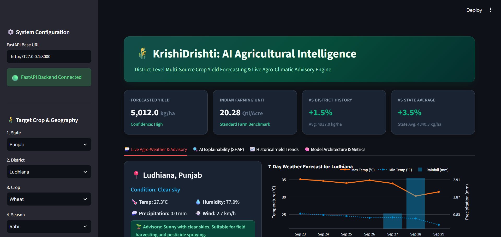

# 🌾 KrishiDrishti: AI-Based Multi-Source Crop Yield Forecasting & Agro-Intelligence Platform

[](https://www.python.org/)
[](https://fastapi.tiangolo.com/)
[](https://streamlit.io/)
[](https://xgboost.readthedocs.io/)
[](https://shap.readthedocs.io/)
[](LICENSE)

> **KrishiDrishti** (कृषि दृष्टि) is an end-to-end, production-grade Artificial Intelligence and Agro-Climatic Intelligence system designed for district-level crop yield forecasting across India. It integrates **77,000+** historical government census records, an optimized **XGBoost Regressor**, **SHAP** local interpretability, live agro-meteorological data from the **Open-Meteo Weather API**, and a modern **Streamlit** dashboard served by a decoupled **FastAPI** REST backend.

---

## 📸 System Preview



---

## 📌 Table of Contents

- [Problem Statement & Background](#-problem-statement--background)
- [Key Features](#-key-features)
- [System Architecture](#-system-architecture)
- [Data Pipeline & Preprocessing](#-data-pipeline--preprocessing)
- [Machine Learning Methodology](#-machine-learning-methodology)
- [Model Evaluation & Benchmarking](#-model-evaluation--benchmarking)
- [Project Directory Structure](#-project-directory-structure)
- [Installation & Quickstart](#-installation--quickstart)
- [REST API Reference](#-rest-api-reference)
- [Agricultural Units & Conversions](#-agricultural-units--conversions)
- [Automated Testing](#-automated-testing)
- [Future Enhancements](#-future-enhancements)

---

## 🎯 Problem Statement & Background

Accurate crop yield prediction is a cornerstone of modern agrarian economies. In India, agricultural productivity varies significantly across states, agro-climatic zones, and crop seasons:
* **Crop Insurance (PMFBY)**: Government schemes require reliable district-level yield benchmarks to process compensation and assess losses.
* **Farmer Advisory**: Smallholder farmers need data-backed yield expectations to plan resource allocation (seeds, fertilizers, irrigation).
* **Supply Chain & Food Security**: Policymakers and logistics planners require early forecasts to manage procurement and buffer stocks.

**KrishiDrishti** addresses these challenges by replacing guesswork with an empirical, multi-source forecasting model that pairs historical longitudinal yield persistence with real-time weather conditions.

---

## 🌟 Key Features

1. **High-Accuracy ML Forecasting Engine**:
   - Benchmarked on 77,000+ longitudinal district records covering 30+ states and union territories.
   - Delivers predictions with an **$R^2 \approx 0.865$** on future holdout test sets without data leakage.

2. **Dual-Metric Output (Scientific & Indian Farm Standard)**:
   - Scientific standard: **kg / hectare (kg/ha)**
   - Traditional Indian agricultural metric: **Quintals / acre (Qtl/Acre)**

3. **Live Agro-Weather Integration**:
   - Queries the Open-Meteo API using dynamic district geocoding across India.
   - Provides real-time temperature (°C), relative humidity (%), precipitation (mm), wind speed (km/h), and a 7-day agricultural weather forecast.
   - Auto-generates tailored farming advisories (e.g., harvesting timing, pesticide windows, drainage alerts).

4. **Explainable AI (SHAP)**:
   - Integrated TreeSHAP decomposes the exact contribution of each factor (e.g., prior year yield baseline, district historical productivity, crop potential) to ensure full transparency.

5. **Decoupled Modern Architecture**:
   - **Backend**: High-throughput FastAPI REST API with Pydantic v2 schemas and auto-generated Swagger UI (`/docs`).
   - **Frontend**: Interactive Streamlit dashboard featuring cascading geographic dropdowns, glassmorphism KPI cards, and Plotly historical trend analytics.

---

## 🏗️ System Architecture

```mermaid
flowchart TD
    subgraph Data_Pipeline [1. Data Cleaning & Model Serialization]
        A["DES Agricultural Census (2016-2025)"] --> B["Data Cleaning & Outlier Removal (train_export.py)"]
        B --> C["artifacts/model.joblib (Tuned XGBoost)"]
        B --> D["artifacts/preprocessor.joblib (Encodings)"]
        B --> E["artifacts/yield_lookup.csv (Lag Yields)"]
    end

    subgraph Backend_Services [2. FastAPI REST Backend (Port 8000)]
        C & D & E --> F["Inference Service (inference_service.py)"]
        G["Open-Meteo Global Weather API"] --> H["Weather Service (weather_service.py)"]
        F & H --> API["FastAPI Gateway (backend/main.py)"]
        API --> Endpoints["Endpoints: /api/predict, /api/weather, /api/metadata, /api/historical-trends"]
    end

    subgraph User_Interface [3. Streamlit Frontend (Port 8501)]
        Endpoints --> UI["Streamlit Dashboard (frontend/app.py)"]
        UI --> Card1["Forecasted Yield (kg/ha & Quintal/acre)"]
        UI --> Card2["Live Weather & Agro-Advisory Widget"]
        UI --> Card3["SHAP Feature Waterfall Explanation"]
        UI --> Card4["Interactive Longitudinal Trend Chart"]
    end
```

---

## 📊 Data Pipeline & Preprocessing

The historical dataset is synthesized from the **Directorate of Economics and Statistics (DES)**, Ministry of Agriculture & Farmers Welfare, Government of India:
* **Panel Periods Merged**: 2016–17 to 2018–19, 2019–20 to 2021–22, 2022–23 to 2024–25.
* **Cleaning & Filtering**:
  * Stripped aggregate macro categories (`Cereals`, `Nutri/Coarse Cereals`, `Total Food Grains`).
  * Removed non-specific seasonal aggregates (`Season == "Total"`).
  * Reshaped wide panel columns (`Yield-2016-17`, etc.) into a normalized longitudinal structure (`State, District, Crop, Season, Year, Yield_Kg_Ha`).
* **Defensible Crop-Aware Outlier Removal**:
  * Rather than applying a blunt global cutoff (which erroneously discards high-yielding crops like Sugarcane or distorts low-yielding pulses like Urad), a crop-specific Interquartile Range rule was enforced:
    $$\text{Upper Bound} = Q_3 + 3 \times IQR \quad (\text{per crop})$$
  * Removed 319 data-entry errors (e.g., Urad entered as 385,540 kg/ha) while retaining legitimate zero-yield rows representing crop failure.

---

## 🧠 Machine Learning Methodology

### 1. Leakage-Free Chronological Split
Random row-level train/test splits cause future-to-past data leakage in time-series agricultural forecasting. We enforced a **chronological holdout**:
* **Training Set**: 2016–17 through 2022–23
* **Test Set**: 2023–24 and 2024–25

### 2. Feature Engineering
* **`lag_yield`**: Yield of the identical (State, District, Crop, Season) combination in the previous recorded year.
* **`District_te` & `State_te`**: Smoothed empirical Bayes target encodings computed strictly on past training records:
  $$\text{Encoded} = \frac{\bar{y}_{\text{group}} \cdot n + \bar{y}_{\text{global}} \cdot m}{n + m} \quad (m=10)$$
* **One-Hot Encodings**: Categorical representations for crops and seasons.

---

## 📈 Model Evaluation & Benchmarking

| Model Architecture | Train $R^2$ | Holdout Test $R^2$ | Test RMSE (kg/ha) | Test MAE (kg/ha) | Generalization Diagnosis |
| :--- | :---: | :---: | :---: | :---: | :---: |
| **Linear Regression** (Baseline) | 0.789 | 0.849 | 518.9 | 321.7 | Underfitting non-linear interactions |
| **Random Forest** (Unconstrained) | 0.983 | 0.852 | 514.3 | 306.3 | **Severe Overfitting** (Gap = 0.131) |
| **Random Forest** (Regularized: depth=10) | 0.870 | 0.858 | 503.6 | 298.8 | Healthy generalization |
| **XGBoost Regressor** (Tuned) | **0.879** | **0.865** | **491.4** | **296.7** | **Best Performance (Selected 🏆)** |

* **Grouped 5-Fold Cross Validation (by District)**: Confirmed performance with a Mean $R^2 = 0.8500 \pm 0.0113$.
* **SHAP Explainability**: Verified that while `lag_yield` serves as a strong anchor, district productivity and crop potentials provide essential localized calibration.

---

## 📁 Project Directory Structure

```
AI-Crop-Yield-Prediction/
├── artifacts/                                 # Serialized model artifacts
│   ├── model.joblib                           # Trained XGBoost Regressor
│   ├── preprocessor.joblib                    # Encodings, maps, and feature column lists
│   └── yield_lookup.csv                       # Historical yield reference for lag lookups
├── backend/                                   # FastAPI application package
│   ├── __init__.py
│   ├── main.py                                # API routers, CORS, and lifespan event
│   ├── schemas.py                             # Pydantic v2 request/response models
│   └── services/
│       ├── __init__.py
│       ├── inference_service.py               # Lag resolution, inference, and SHAP
│       └── weather_service.py                 # Open-Meteo weather integration
├── frontend/                                  # Streamlit user interface
│   ├── __init__.py
│   └── app.py                                 # Interactive dashboard UI
├── tests/                                     # Automated test suite
│   └── test_api.py                            # Pytest endpoints and service tests
├── agricultural_yield_india_cleaned_long.csv  # 77,000+ cleaned census records
├── app.py                                     # Root entrypoint redirecting to frontend/app.py
├── train_export.py                            # Offline model training & serialization script
├── requirements.txt                           # Python project dependencies
├── dashboard_preview.png                      # Application visual preview
└── README.md                                  # Complete documentation
```

---

## 🚀 Installation & Quickstart

### 1. Prerequisites
* Python 3.10, 3.11, or 3.12
* Windows, Linux, or macOS

### 2. Environment Setup

Clone the repository and set up a virtual environment:

```powershell
# Using uv (fastest)
uv venv .venv
.venv\Scripts\activate
uv pip install -r requirements.txt

# Or using standard python
python -m venv .venv
.venv\Scripts\activate
pip install -r requirements.txt
```

### 3. Model Training & Artifact Generation

If you wish to retrain or rebuild the model artifacts from scratch:

```powershell
python train_export.py
```
This processes the dataset, fits the XGBoost model, and generates `model.joblib`, `preprocessor.joblib`, and `yield_lookup.csv` in the `artifacts/` folder.

### 4. Running the System

You can run the backend and frontend simultaneously:

#### Terminal 1 — Start the FastAPI Backend:
```powershell
uvicorn backend.main:app --reload --port 8000
```
* **Swagger OpenAPI Docs**: [http://127.0.0.1:8000/docs](http://127.0.0.1:8000/docs)
* **API Health Check**: [http://127.0.0.1:8000/health](http://127.0.0.1:8000/health)

#### Terminal 2 — Start the Streamlit Frontend:
```powershell
streamlit run app.py
```
* The UI will automatically launch in your browser at **[http://localhost:8501](http://localhost:8501)**.

---

## 📡 REST API Reference

The backend exposes fully typed REST endpoints with interactive documentation available at `/docs`:

### 1. Predict Crop Yield
* **Endpoint**: `POST /api/predict`
* **Description**: Computes predicted yield, benchmark comparisons, and top SHAP drivers.
* **Request Body**:
  ```json
  {
    "state": "Punjab",
    "district": "Ludhiana",
    "crop": "Wheat",
    "season": "Rabi",
    "year": 2025,
    "custom_lag_yield": null
  }
  ```
* **Response Body**:
  ```json
  {
    "state": "Punjab",
    "district": "Ludhiana",
    "crop": "Wheat",
    "season": "Rabi",
    "year": 2025,
    "predicted_yield_kg_ha": 5012.0,
    "predicted_yield_quintal_acre": 20.28,
    "lag_yield_used": 5132.0,
    "is_lag_estimated": false,
    "district_avg_yield": 4937.0,
    "state_avg_yield": 4840.3,
    "delta_vs_district_pct": 1.5,
    "delta_vs_state_pct": 3.5,
    "confidence_level": "High",
    "shap_feature_importance": [
      {
        "feature": "lag_yield",
        "feature_name_clean": "Prior Year Yield (5132.0 kg/ha)",
        "impact": 2159.6,
        "value": 5132.0
      },
      {
        "feature": "crop_Wheat",
        "feature_name_clean": "Crop Potential (Wheat)",
        "impact": 519.1,
        "value": 1.0
      }
    ]
  }
  ```

### 2. Live Agro-Weather & 7-Day Forecast
* **Endpoint**: `GET /api/weather?district=Ludhiana&state=Punjab`
* **Response**: Returns current temperature, humidity, rainfall, wind speed, condition, agricultural advisory, and daily 7-day forecasts.

### 3. Cascading Geographic & Crop Metadata
* **Endpoint**: `GET /api/metadata`
* **Response**: Returns lists of all available states, cascading districts per state, crops, and seasons.

### 4. Longitudinal Historical Trends
* **Endpoint**: `GET /api/historical-trends?state=Punjab&district=Ludhiana&crop=Wheat`
* **Response**: Returns historical time series (2016–2024), all-time peak, minimum, and multi-year average yield.

---

## 🌾 Agricultural Units & Conversions

To ensure practical utility for Indian farmers, extension workers, and agronomists, yields are reported in two primary standards:

1. **Metric Scientific Standard**:
   $$\text{Yield} \quad (\text{kg / hectare})$$
2. **Indian Farm Standard**:
   $$\text{Quintals / Acre} \quad (\text{Qtl/Acre})$$

**Conversion Formula**:
$$1 \text{ Quintal} = 100 \text{ kg}, \quad 1 \text{ Hectare} \approx 2.47105 \text{ Acres}$$
$$\text{Yield}_{\text{Qtl/Acre}} = \text{Yield}_{\text{kg/ha}} \times \left(\frac{0.01}{2.47105}\right) \approx \text{Yield}_{\text{kg/ha}} \times 0.00404686$$

*Example*: A wheat yield of **5,012 kg/ha** equates to **20.28 Quintals/Acre**.

---

## 🧪 Automated Testing

The project includes unit and integration tests using `pytest` and FastAPI's `TestClient`:

```powershell
.venv\Scripts\python.exe -m pytest tests/test_api.py -v
```

**Test Coverage**:
* `test_health`: Verifies API health and artifact initialization.
* `test_weather_service_direct`: Verifies live Open-Meteo API resolution and fallback recovery.
* `test_metadata_endpoint`: Checks state/district/crop catalogs.
* `test_prediction_endpoint`: Validates end-to-end inference, unit conversions, and SHAP calculation.
* `test_historical_trends_endpoint`: Checks time-series query resolution.

---

## 🔮 Future Enhancements

* **Satellite Vegetation Indices (NDVI)**: Ingest Sentinel-2 and MODIS NDVI rasters to capture real-time crop canopy vigor during mid-season.
* **Soil Health Card Integration**: Merge soil organic carbon (SOC), Nitrogen, Phosphorus, and Potassium (NPK) district maps.
* **Multilingual Interface**: Support major regional Indian languages (Hindi, Punjabi, Telugu, Marathi, Tamil) via i18n localization.

---

## 👨‍💻 Contributors & Acknowledgments

* **Data Source**: Directorate of Economics and Statistics (DES), Ministry of Agriculture & Farmers Welfare, Government of India.
* **Weather Service**: [Open-Meteo Global Weather API](https://open-meteo.com/).
* **Libraries**: XGBoost, Scikit-learn, FastAPI, Streamlit, SHAP, Plotly, Pandas.